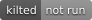
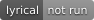

# duatic_gazebo
[](https://github.com/Duatic/duatic_gazebo/actions/workflows/ci.yml)
[](https://github.com/Duatic/duatic_gazebo/actions/workflows/ci.yml)
[](https://github.com/Duatic/duatic_gazebo/actions/workflows/ci.yml)
[](https://github.com/Duatic/duatic_gazebo/actions/workflows/ci.yml)

## Overview

Provides Gazebo simulation worlds, robot spawning, and ROS-Gazebo bridge configuration for Duatic robots. Includes empty world and warehouse environment with AWS RoboMaker assets.

# License

The contents are licensed under the BSD-3-Clause  [license](LICENSE).\
Images in this repository are to be licensed separately if you want to use them for any other usecase than forking this repository. Please open an issue in order to get in touch with us.


## Usage

### Launch Simulation Environment

#### Using ROS Node (Recommended)

The `start_sim` node provides a managed way to start and stop the simulation. It automatically ensures the simulation container is properly shut down when the node terminates.

It runs `docker compose`, so it needs ROS 2 and the Docker CLI on the same machine, such as a host
with ROS installed. Inside a dev container without Docker, use the launch file below instead.

```bash
# Empty world (default)
ros2 run duatic_gazebo start_sim.py

# Warehouse world
ros2 run duatic_gazebo start_sim.py --ros-args -p world:=warehouse

# Headless simulation
ros2 run duatic_gazebo start_sim.py --ros-args -p world:=warehouse -p headless:=true
```

**Benefits:**
- Automatic cleanup: Docker container is stopped when node shuts down (Ctrl+C)
- ROS integration: Works as a standard ROS node with parameters
- Process management: Proper lifecycle handling

#### Using Launch File Directly

```bash
# Empty world (default)
ros2 launch duatic_gazebo gazebo.launch.py

# Warehouse world
ros2 launch duatic_gazebo gazebo.launch.py world:=warehouse

# Headless simulation
ros2 launch duatic_gazebo gazebo.launch.py world:=warehouse headless:=true
```

### Spawn Robot

Prerequisite: URDF is being published with the topic /{namespace}/robot_description

```bash
# Basic spawn
ros2 launch duatic_gazebo spawn.launch.py namespace:=robot1 spawn_pose:="[0.0, 0.0, 1.0, 0.0]"

# Multiple robots
ros2 launch duatic_gazebo spawn.launch.py namespace:=alpha spawn_pose:="[0.0, 0.0, 1.0, 0.0]" &
ros2 launch duatic_gazebo spawn.launch.py namespace:=beta spawn_pose:="[2.0, 2.0, 1.0, 1.57]" &
```

### ROS-Gazebo Bridge

```bash
# Launch bridge with config file
ros2 launch duatic_gazebo ros_gz_bridge.launch.py \
  namespace:=robot1 \
  world:=warehouse \
  config_file:=/path/to/bridge_config.yaml
```

### Gazebo Inside rqt

The `Gazebo` rqt plugin shows the Gazebo GUI window inside an rqt panel. Open it from
`Plugins > Visualization > Gazebo`, or on its own:

```bash
rqt --standalone duatic_gazebo/GazeboView
```

rqt and Gazebo can be started in either order. The panel waits until a Gazebo window exists, and picks up the
next one after Gazebo is closed and started again. Closing the panel or rqt puts the window back on the desktop.

The plugin moves the existing window instead of copying its image, so it needs an X11 session and a simulation
started with a GUI (not `headless:=true`). It embeds one Gazebo window at a time.

### Simulated DuaDrive

`duatic_gazebo/SimDuaDriveSystem` is a `gz_ros2_control` hardware plugin that simulates DuaDrive joints. It
replaces `gz_ros2_control/GazeboSimSystem` in one `<ros2_control>` element. A joint of that element is a
simulated drive if it carries the params `sim_p_gain`, `sim_i_gain` and `sim_d_gain`; every other joint behaves
as with the stock plugin.

A drive joint offers the command interfaces `position`, `velocity`, `effort`, `p_gain`, `i_gain` and `d_gain`,
and the state interfaces `position`, `velocity` and `effort`. The params give the gains the drive starts with.
A NaN target, or a NaN or negative gain, written by a controller is ignored and the previous value kept.

The drive picks its law from the command interfaces that active controllers claim on the joint:

| Claimed | Law, applied on every physics step |
|---------|------------------------------------|
| `position` (with or without `velocity`, `effort`), or nothing | `tau = p_gain * (position - q) + d_gain * (velocity - qd) + i_gain * integral(position - q) + effort`, clamped to the URDF effort limit |
| `effort` only | the commanded effort, clamped to the URDF effort limit |
| `velocity`, without `position` | Gazebo's joint velocity command, as with the stock plugin |

With nothing claimed the drive holds its last position target, so an idle joint stays where it is. Whenever the
claimed set of a joint changes, its velocity and effort targets are set to zero and the integral to zero. Its
position target is set to the measured position if the law before the change was the effort or velocity law, and
kept if it was the first law. The gains keep their values.

The config file names the `<ros2_control>` element and, per drive joint, the gains and an armature in kg m²:

```yaml
hardware: TestSystem
joints:
  heavy:
    p_gain: 300.0
    i_gain: 0.0
    d_gain: 25.0
    armature: 0.06
```

`apply_sim_drive` takes a URDF string and a loaded config, switches that element to the plugin, adds the gain
params to each listed joint and adds the armature to the inertia of the joint's child link: the full value about
the joint axis and half of it about the perpendicular axes, so the link inertia stays valid. A link whose inertia
is invalid is an error naming the link. Because of the perpendicular halves, every joint further up the chain
sees an extra `armature / 2` per downstream drive link about its own axis, which a per-joint armature in a
training simulator does not add.

A drive joint needs a positive effort limit in the URDF; without one the plugin fails to start and names the
joint.

The commands below run inside the dev container. From this package's source directory:

```bash
python3 -c "
from duatic_gazebo.sim_drive import apply_sim_drive, load_sim_drive_config
urdf = open('test/urdf/sim_duadrive_test.urdf').read()
print(apply_sim_drive(urdf, load_sim_drive_config('test/config/sim_duadrive_test.yaml')))
"
```

The launch test `test/launch_sim_duadrive.py` spawns a test robot with two drive joints and a wheel and checks
each law. From the workspace root:

```bash
colcon test --packages-select duatic_gazebo --ctest-args -R launch_sim_duadrive --event-handlers console_direct+
```

## Launch Files

| File | Description |
|------|-------------|
| `gazebo.launch.py` | Main simulation environment |
| `spawn.launch.py` | Robot spawning interface |
| `ros_gz_bridge.launch.py` | ROS-Gazebo topic bridge |

## Nodes

### start_sim.py

ROS 2 node that manages the simulation Docker container lifecycle.

**Parameters:**
- `world` (string, default: "empty"): World name to load
- `headless` (bool, default: false): Run simulation without GUI
- `gpu` (bool, default: false): Pass the host's NVIDIA GPUs into the container for rendering. Needs
  the NVIDIA Container Toolkit.

**Environment:**
- `SIM_IMAGE`: image the container runs, default `ghcr.io/duatic/dynaarm-dev:<ROS_DISTRO>`. Set it
  to your product's dev image when the robot you spawn has meshes the default image lacks.
- `ROS_DOMAIN_ID`, `GZ_PARTITION`, `CYCLONEDDS_IFACE` and `CYCLONEDDS_PEER` are passed into the
  container, so the simulation joins the same ROS domain and Gazebo partition as the caller.
- The container runs as the calling user, whom the node admits to the X server with `xhost`.

**Features:**
- Starts simulation container using docker compose
- Automatically stops container on node shutdown
- Proper cleanup with Ctrl+C
- ROS parameter support

**Example:**
```bash
ros2 run duatic_gazebo start_sim.py --ros-args -p world:=warehouse -p headless:=false
```

## Parameters

### gazebo.launch.py
| Parameter | Default | Description |
|-----------|---------|-------------|
| `world` | `"empty"` | World name (empty, warehouse) |
| `headless` | `false` | Run without GUI |
| `gz_models_path` | `""` | A ':'-separated list of Gazebo resource search paths |

### spawn.launch.py
| Parameter | Default | Description |
|-----------|---------|-------------|
| `namespace` | `"empty_namespace"` | Robot namespace |
| `spawn_pose` | `[0.0, 0.0, 0.0, 0.0]` | Spawn pose `[x, y, z, yaw]` (all floats) |

### ros_gz_bridge.launch.py
| Parameter | Default | Description |
|-----------|---------|-------------|
| `namespace` | `"empty_namespace"` | Robot namespace |
| `world` | `"undefined"` | World name |
| `config_file` | - | Bridge configuration file |

## Available Worlds

- **duatic_empty**: Minimal environment for basic testing
- **warehouse**: AWS RoboMaker warehouse with shelves, pallets, and clutter
- **bag_lifting**: Demo booth with a wall, pallet, table, and rice bags, used for pick/place demos
- **bag_sorting**: Six bags on three tables, can be sorted onto the pallets
- **bag_sorting_single**: One bag on the middle table, for general application testing

A world per scenario beats clearing objects at runtime: with the objects already in place,
a fresh simulation is the reset. Occupancy maps live in `maps/`, one pair per world under
the same basename, and are derived from the world geometry, so move a wall in the `.sdf`
and the map is silently wrong. Maps recorded at a real site are instance data and live in
`/srv/duatic/maps`.

`scripts/sdf_to_map.py` regenerates a world's map by slicing its visual geometry, which is
what a simulated LIDAR renders (default height 0.25 m, override with `--height`).

```bash
python3 scripts/sdf_to_map.py worlds/warehouse.sdf
```

## Assets

### AWS RoboMaker Models
- Warehouse infrastructure (shelves, walls, ground)
- Props (buckets, lamps, trash cans, pallet jacks)
- Clutter objects for realistic environments

### Bag Lifting Demo Models
- Demo booth (`booth`)
- Pallet, table, and rice bag props (`pallet`, `table`, `bag`)


# Contributing

Please see the [Contributing guide](./CONTRIBUTING.md)
